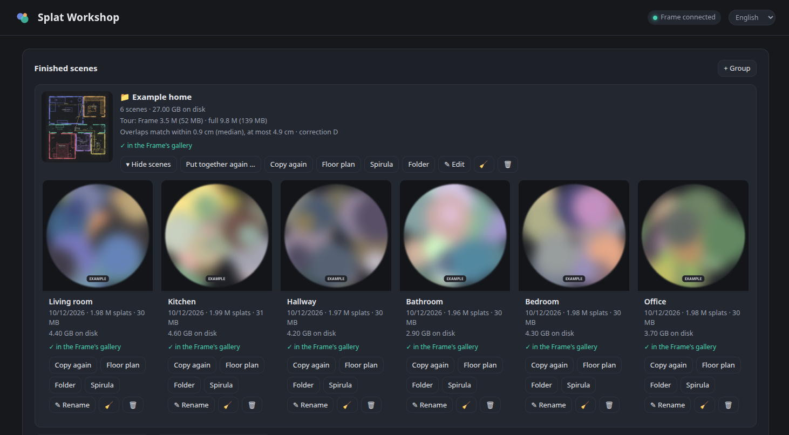
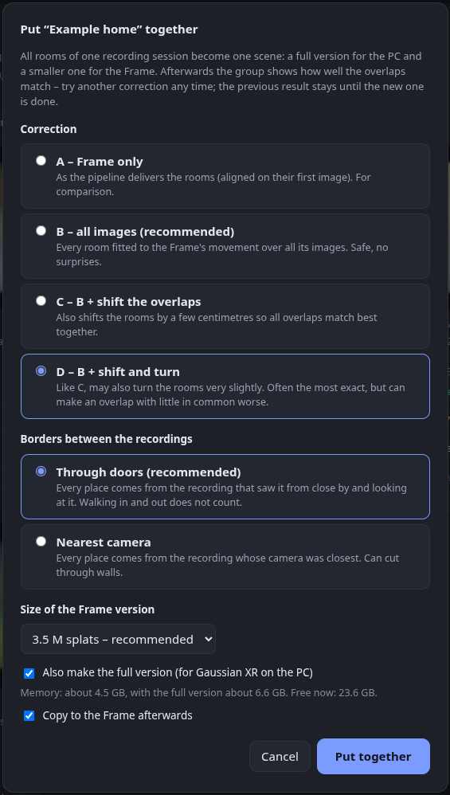
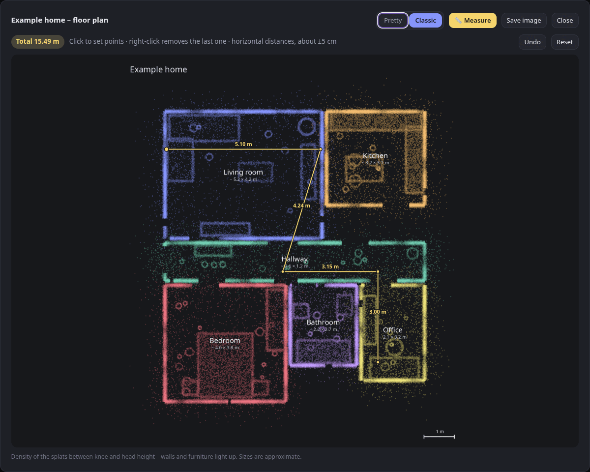

# Splat Workshop

**A graphical interface for the Arcturus Vision reconstruction pipeline: pick a recording from the Arcturus Vision Camera on your Steam Frame, check it, run the conversion and get the result straight into the Gaussian XR gallery on the headset. With a web interface, a tray icon and a recording check.**

  [](https://github.com/thunderheronight/splat-workshop/releases) [](https://github.com/thunderheronight/splat-workshop/actions/workflows/tests.yml)

> **No root, no jailbreak.** On the Frame, Splat Workshop only uses the official *Developer Mode* from the Steam settings and SSH as the normal user – nothing is installed on the headset and its system stays untouched. On the PC it runs as your user, too (only the prerequisites like ffmpeg come from your package manager).

[Deutsch](README.de.md)


<sub>Example screenshot – the recording thumbnails are replaced by placeholder art.</sub>

Rooms, a statue, your car, a garden – anything you can walk around with the camera can become a scene you step into.

Splat Workshop does not compute the splats itself: the reconstruction is done by the [Arcturus Vision](https://arcturus.vision) pipeline and Spirula Studio. Splat Workshop is the GUI around them – it prepares the inputs, starts and monitors the pipeline and takes care of everything before and after.

Arcturus Vision publishes the reconstruction scripts and a Spirula Studio fork, but turning a recording into a scene you can open in [Gaussian XR](https://store.steampowered.com/app/3977540/Arcturus_Vision_Gaussian_XR/) means a lot of manual steps. Splat Workshop wraps the whole path in a local web interface:

1. **Pick a recording** directly from the Frame (over SSH) or from your PC, with thumbnails.
2. **Check it** before spending an hour on it: brightness, structure, fast pans and covered lenses, second by second.
3. **Convert it** with a quality preset (Fast / High / Maximum) or fine-tuned values, with live progress, ETA and a PSNR curve.
4. **Put it in the gallery**: preview image and name plate in the look of the bundled example scenes, copied into Gaussian XR's `Scenes` folder on the Frame.
5. **Put your home together**: group the rooms and turn them into one tour you walk through – full size for the PC, smaller for the Frame.

## New in 0.2

- 🏠 **Your whole home as one scene** – group rooms and *put the tour together*: the rooms of one recording session are fitted to each other and joined into one walkable scene, in a full version for the PC and a smaller one for the Frame.
- 🎯 **Seamless transitions** – four corrections to choose from; the group shows how well the rooms meet (typically within 1–2 cm), so you can compare.
- 📁 **Groups** keep the list tidy – suggested automatically for rooms recorded one after another.
- 🧹 **Disk usage, clean-up, delete** per scene, and a list of **cancelled runs** to resume or remove.
- 🛡️ **Safer**: *Start over* keeps the old scene until the new one is done; the PC no longer goes to sleep mid-conversion.


<br><sub>Example data – room names and preview images are placeholders; the tour preview is the synthetic example home.</sub>

All changes: [CHANGELOG.md](CHANGELOG.md)

## Features

- **Web interface** (Python standard library only) – also from your phone or a second PC in your home network if you want.
- **Tray icon**  – shows whether Splat Workshop is running and what it is doing (progress ring). Open, cancel a conversion, quit. Quitting during a conversion asks whether to let it finish in the background or cancel it.
- **Conversions survive everything**: they run as their own process; close the browser, quit the tray, restart – reopen Splat Workshop and you see the progress again.
- **Cancel & resume**: a cancelled conversion continues from its last saved state.
- **Recording check** without AI: plain per-second measurements with a colour-coded timeline and concrete hints (“0:45–0:59 little structure”). See [What the check measures](#what-the-check-measures).
- **Groups and tours**: group scenes (e.g. all rooms of your home) and put them together into one scene – a full version for Gaussian XR on the PC and a smaller one for the Frame. Recordings from one session share the Frame's tracking frame; Splat Workshop fits the rooms to each other (corrections A–D to choose), lets the borders between recordings run through doors and shows how well the rooms meet. Before starting it estimates the memory needed.
  <br>
  <br><sub>Example data – room names and preview images are placeholders.</sub>
- **Floor plans** *(experimental)* of single scenes or a whole group – recordings from one session line up by themselves into a plan of your whole home. Two styles: *Pretty* (colour top view, walls, the path you walked) and *Classic* (glowing point density), plus a simple measuring tool (click points, get distances – about ±5 cm).
  <br>
  <br><sub>Example home – synthetic data, drawn with the same renderer. Combining rooms relies on the Frame keeping its tracking frame between recordings; how well that holds for a whole home is still being tested.</sub>
- **Finished scenes**: copy to the Frame later, re-copy, rename (folder and name plate follow), delete (to the trash), open the folder or open the scene in Spirula Studio.
- **Disk usage and clean-up**: each scene shows how much space it takes (about 4 GB for a room). One click deletes the intermediate data or the training images – the scene, floor plan and viewer keep working.
- **Cancelled runs** are listed with how far they got: resume, start over or delete.
- **Rename recordings** on the PC; the recording date and check results are kept.
- English and German interface (automatic, switchable). More languages welcome – see `web/i18n.js` and `splat_workshop/i18n.py`.

## Requirements

- **Linux** with a GPU that runs Spirula Studio (Vulkan; tested on Nobara/Fedora with an NVIDIA RTX 4070 SUPER, 12 GB). Splat Workshop uses Linux desktop tools (`xdg-open`, `notify-send`, KDE/GNOME file dialogs). macOS is untested – the Arcturus pipeline runs there, Splat Workshop would need small changes. Windows is not supported, since Arcturus does not support its reconstruction scripts on Windows yet.
- A **Steam Frame** with the **Arcturus Vision Camera** – recordings are the `*_stereo.mp4` files from the Arcturus camera app (two video tracks plus a calibration/pose track). Normal videos do not work.
- **Python 3.11+**, **ffmpeg/ffprobe**, **[uv](https://docs.astral.sh/uv/)**, **ssh**, **curl**
- **Node.js** for [`splat-transform`](https://github.com/playcanvas/splat-transform): `npm install -g @playcanvas/splat-transform`
- The **Arcturus reconstruction scripts** (`av1-3dgs-pipeline`) from [arcturus.vision/apps](https://arcturus.vision/apps) – not included here, download them yourself.
- **Spirula Studio**, built from the Arcturus fork exactly as described in the pipeline's README (branch `sfm-calibrated-manifest`, Vulkan backend).

  → **Step-by-step: [Setting up the Arcturus pipeline on Linux](docs/arcturus-setup.md)** (packages, Spirula build, known pitfalls).

- Optional for the tray icon: **PySide6** (`sudo dnf install python3-pyside6` / `sudo apt install python3-pyside6.qtwidgets`) – otherwise `uv` fetches it on first start. On GNOME you need the *AppIndicator* extension to see tray icons.

## Install

```bash
git clone https://github.com/thunderheronight/splat-workshop.git
cd splat-workshop
./install.sh --desktop            # menu entry + desktop shortcut; add --autostart for the tray at login
```

Then edit `~/.config/splat-workshop/config.toml`:

```toml
[paths]
pipeline = "~/arcturus/av1-3dgs-pipeline"
spirula  = "~/arcturus/spirula-studio/build_vulkan/spirula"

[frame]
host = "steamos@192.168.1.50"     # your Frame's address
```

Splat Workshop shows what is still missing at the top of the page.

### SSH access to the Frame

Downloading recordings and copying scenes uses SSH with a key:

1. On the Frame: **Steam Settings → System → Enable Developer Mode**.
2. In the left-hand menu, scroll down to **Developer**, and near the bottom of that page choose **Set User Password**. There is no default password – SSH works only after you set one. ([Valve's docs](https://partner.steamgames.com/doc/steamhardware/steamframe/setup))
3. Find the Frame's address: its IP is shown under **Steam Settings → Internet** (or in your router); the hostname can be set under **Steam Settings → System → Hostname**.
4. On your PC: `ssh-copy-id steamos@<frame address>` (enter the password once), then check that `ssh steamos@<frame address>` logs in without asking.
5. Give the Frame a fixed IP address in your router so it does not change, and put `steamos@<that address>` into `[frame] host` in the config.

## Usage

Start **Splat Workshop** from the menu (or `./splat-workshop`). The tray icon appears and the page opens in your browser.

| Command | |
|---|---|
| `./splat-workshop` | tray icon + open the page |
| `./splat-workshop --background` | tray icon only (autostart) |
| `./splat-workshop --no-tray` | without tray; the server stops itself after 20 idle minutes |
| `./splat-workshop --server` | server in the foreground |
| `scripts/splat.sh <recording> "<name>"` | convert on the command line (`QUALITY=fast\|high\|max`, `NO_UPLOAD=1`, `--resume`) |
| `scripts/to-frame.sh <run> "<name>"` | (re)copy a finished scene to the Frame |
| `scripts/combine.sh <name> "<display name>" <run>=<label> ...` | put scenes together into a tour (`ALIGN=frame\|images\|shift\|rigid`, `FRAME_SPLATS`, `FULL=0`, `NO_UPLOAD=1`) |

After copying, **restart Gaussian XR** on the Frame so the new scene appears in the gallery. A Steam “verify files” or app update can reset Gaussian XR's `Scenes` folder – Splat Workshop also keeps a copy in `~/Documents/GaussianSplats` on the Frame, and *Copy again* restores a scene.

### Access from other devices

Set `lan = true` in `[server]`. The page is then reachable at `http://<pc address>:8771/` from your home network (only private network addresses are accepted, other websites cannot send commands to it). Actions that open windows on the PC (video player, folder, Spirula, file dialog) and quitting are only available on the PC itself. There is no login – only enable this in a network you trust.

## Recording tips

- **Light**: daylight plus room lights indoors. Dark recordings get noisy and patchy.
- **HDR, 30 fps** in the camera app works best; the pipeline tone-maps HLG automatically. Don't use “Linear”.
- **Rooms**: 30–90 s each, walk slowly, turn slowly, look at things from several sides.
- **Objects**: walk around them in a slow circle (15–40 s) and keep them in the middle of the picture.
- Avoid pointing at **bare walls, ceilings or tiles** for long – there is nothing for the software to hold on to.
- Moving people or pets become ghostly smears.

## What the check measures

Per second (from the keyframes of both cameras, about 5–15 s per recording):

| | |
|---|---|
| **brightness** | very dark passages |
| **edge strength** (Sobel) | bare walls, ceilings, tiles, blur – where camera positions are hard to determine |
| **difference to the previous second** | fast pans |
| **left vs. right camera** | covered or smudged lens |
| **almost white pixels**, **colour cast**, **length** | hints |


It is a measurement, not image recognition: it does not detect people or moving objects. The thresholds were calibrated on HLG recordings of the Arcturus camera; they are constants at the top of `splat_workshop/check.py`.

## Quality presets

| | image pairs | resolution | max. splats | steps | time* |
|---|---|---|---|---|---|
| Fast | 100 | ½ | 1.5 M | 30k | ~10 min |
| High | 5 per second (100–500) | full | 2 M | 30k | ~35–50 min |
| Maximum | 8 per second (100–500) | full | 3 M | 50k | ~1.5 h+ |

\* RTX 4070 SUPER. Spirula keeps training images on disk, so 12 GB of VRAM are enough for “High”. A run needs a few GB of free disk space.

## Files

```
config:            ~/.config/splat-workshop/config.toml
recordings:        [paths] recordings   (downloaded from the Frame)
scenes:            [paths] runs/<name>/  (scene.sog, spirula/scene.ply, gallery files, intermediate data)
tours:             [paths] runs/<group>/ (scene.sog = Frame version, full/ = full version, spirula/scene.ply, combine.json)
internal state:    next to runs/ in .splat-workshop/ (logs, thumbnails, check results)
```

## Development

Automated tests run on every push ([GitHub Actions](https://github.com/thunderheronight/splat-workshop/actions/workflows/tests.yml)). Run them yourself with:

```bash
uv run --no-project --with pytest --with numpy --with scipy --with pillow pytest
```

They need no GPU, no recordings and no Steam Frame: the Arcturus pipeline, Spirula, splat-transform, ffprobe, the desktop trash and notifications are replaced by small fakes, the Frame is a folder reached through a fake `ssh`/`scp`, and putting rooms together is tested on synthetic rooms with a known error – turned, shifted and scaled reconstructions, tracking noise, drift and turn (`tests/synth.py`).

Covered: who may talk to the server (other websites, LAN mode, malformed or wrongly typed requests, paths outside the runs folder), the recording check, renaming recordings and scenes, clean-up, deleting, cancelled runs, a scene being left alone while it is computed, recovery after a power cut, groups, conversions with cancel/start over/resume (the real `splat.sh`), the Frame's list, downloads and copying scenes over (the real `to-frame.sh`), tours (the real `combine.sh`), the four corrections, splat orientation and size, borders through doors, and that the floor plan is not mirrored. The tests were reviewed independently with mutation testing (deliberately broken code must make them fail). Not covered: the real pipeline, Spirula, the real Frame, the tray icon and the browser interface – those are tested by hand.

## Uninstall

`./install.sh --uninstall` removes the menu entry, icon and autostart. Your config and scenes stay.

## Transparency note

This project was written with the help of AI: the code, the documentation and the example screenshot placeholders were created together with **Claude (Opus 5.5) by Anthropic**, using Claude Code. Ideas, testing on real hardware, decisions and review were done by me. Bug reports are welcome – if something looks off, it may well be a mistake neither of us noticed.

## Credits & license

Splat Workshop is a community tool and **not affiliated with Valve or Arcturus Vision**. It uses the [Arcturus Vision](https://arcturus.vision) reconstruction scripts and their [Spirula Studio](https://github.com/arcturus-vision/spirula-studio) fork, and PlayCanvas [splat-transform](https://github.com/playcanvas/splat-transform) – please follow their licenses and terms.

Splat Workshop itself is licensed under the [GNU General Public License v3.0](LICENSE).
