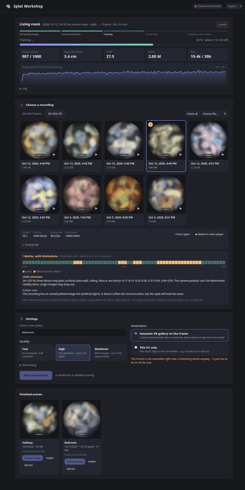
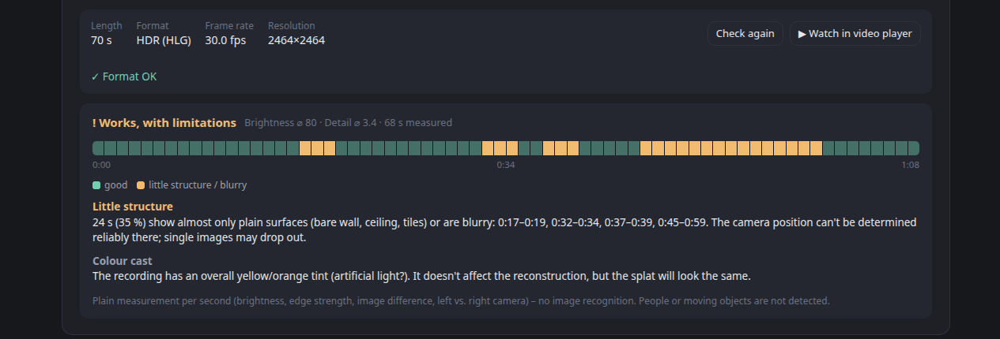

# Splat Workshop

**Turn recordings from the Arcturus Vision Camera on your Steam Frame into Gaussian splats – and straight into the Gaussian XR gallery on the headset. With a web interface, a tray icon and a recording check.**

[Deutsch](README.de.md)



<sub>Example screenshot – the recording thumbnails are replaced by placeholder art.</sub>

Rooms, a person, a statue, your car, a garden – anything you can walk around with the camera can become a scene you step into.

Arcturus Vision publishes the reconstruction scripts and a Spirula Studio fork, but turning a recording into a scene you can open in [Gaussian XR](https://store.steampowered.com/app/3977540/Arcturus_Vision_Gaussian_XR/) means a lot of manual steps. Splat Workshop wraps the whole path in a local web interface:

1. **Pick a recording** directly from the Frame (over SSH) or from your PC, with thumbnails.
2. **Check it** before spending an hour on it: brightness, structure, fast pans and covered lenses, second by second.
3. **Convert it** with a quality preset (Fast / High / Maximum) or fine-tuned values, with live progress, ETA and a PSNR curve.
4. **Put it in the gallery**: preview image and name plate in the look of the bundled example scenes, copied into Gaussian XR's `Scenes` folder on the Frame.

## Features

- **Web interface** (Python standard library only) – also from your phone or a second PC in your home network if you want.
- **Tray icon**  – shows whether Splat Workshop is running and what it is doing (progress ring). Open, cancel a conversion, quit. Quitting during a conversion asks whether to let it finish in the background or cancel it.
- **Conversions survive everything**: they run as their own process; close the browser, quit the tray, restart – reopen Splat Workshop and you see the progress again.
- **Cancel & resume**: a cancelled conversion continues from its last saved state.
- **Recording check** without AI: plain per-second measurements with a colour-coded timeline and concrete hints (“0:45–0:59 little structure”). See [What the check measures](#what-the-check-measures).
- **Finished scenes**: copy to the Frame later, re-copy, open the folder or open the scene in Spirula Studio.
- English and German interface (automatic, switchable). More languages welcome – see `web/i18n.js` and `splat_workshop/i18n.py`.

## Requirements

- **Linux** with a GPU that runs Spirula Studio (Vulkan; tested on an NVIDIA RTX 4070 SUPER, 12 GB). Arcturus does not support its reconstruction scripts on Windows yet.
- A **Steam Frame** with the **Arcturus Vision Camera** – recordings are the `*_stereo.mp4` files from the Arcturus camera app (two video tracks plus a calibration/pose track). Normal videos do not work.
- **Python 3.11+**, **ffmpeg/ffprobe**, **[uv](https://docs.astral.sh/uv/)**, **ssh**, **curl**
- **Node.js** for [`splat-transform`](https://github.com/playcanvas/splat-transform): `npm install -g @playcanvas/splat-transform`
- The **Arcturus reconstruction scripts** (`av1-3dgs-pipeline`) from [arcturus.vision/apps](https://arcturus.vision/apps) – not included here, download them yourself.
- **Spirula Studio**, built from the Arcturus fork exactly as described in the pipeline's README (branch `sfm-calibrated-manifest`, Vulkan backend).
- Optional for the tray icon: **PySide6** (`sudo dnf install python3-pyside6` / `sudo apt install python3-pyside6.qtwidgets`) – otherwise `uv` fetches it on first start. On GNOME you need the *AppIndicator* extension to see tray icons.

## Install

```bash
git clone https://github.com/thunderheronight/splat-workshop.git
cd splat-workshop
./install.sh --desktop            # menu entry + desktop shortcut; add --autostart for the tray at login
```

Then edit `~/.config/splat-workshop/config.toml`:

```toml
[paths]
pipeline = "~/arcturus/av1-3dgs-pipeline"
spirula  = "~/arcturus/spirula-studio/build_vulkan/spirula"

[frame]
host = "steamos@192.168.1.50"     # your Frame's address
```

Splat Workshop shows what is still missing at the top of the page.

### SSH access to the Frame

Downloading recordings and copying scenes uses SSH with a key:

1. On the Frame, in desktop mode: enable SSH and set a password for `steamos` (`passwd`, then `sudo systemctl enable --now sshd`).
2. On your PC: `ssh-copy-id steamos@<frame address>` and check that `ssh steamos@<frame address>` logs in without a password.
3. Give the Frame a fixed address in your router so it does not change.

## Usage

Start **Splat Workshop** from the menu (or `./splat-workshop`). The tray icon appears and the page opens in your browser.

| Command | |
|---|---|
| `./splat-workshop` | tray icon + open the page |
| `./splat-workshop --background` | tray icon only (autostart) |
| `./splat-workshop --no-tray` | without tray; the server stops itself after 20 idle minutes |
| `./splat-workshop --server` | server in the foreground |
| `scripts/splat.sh <recording> "<name>"` | convert on the command line (`QUALITY=fast\|high\|max`, `NO_UPLOAD=1`, `--resume`) |
| `scripts/to-frame.sh <run> "<name>"` | (re)copy a finished scene to the Frame |

After copying, **restart Gaussian XR** on the Frame so the new scene appears in the gallery. A Steam “verify files” or app update can reset Gaussian XR's `Scenes` folder – Splat Workshop also keeps a copy in `~/Documents/GaussianSplats` on the Frame, and *Copy again* restores a scene.

### Access from other devices

Set `lan = true` in `[server]`. The page is then reachable at `http://<pc address>:8771/` from your home network (only private network addresses are accepted, other websites cannot send commands to it). Actions that open windows on the PC (video player, folder, Spirula, file dialog) and quitting are only available on the PC itself. There is no login – only enable this in a network you trust.

## Recording tips

- **Light**: daylight plus room lights indoors. Dark recordings get noisy and patchy.
- **HDR, 30 fps** in the camera app works best; the pipeline tone-maps HLG automatically. Don't use “Linear”.
- **Rooms**: 30–90 s each, walk slowly, turn slowly, look at things from several sides.
- **Objects and people**: walk around them in a slow circle (15–40 s), keep them in the middle of the picture, and ask people to stay completely still.
- Avoid pointing at **bare walls, ceilings or tiles** for long – there is nothing for the software to hold on to.
- Moving people or pets become ghostly smears.

## What the check measures

Per second (from the keyframes of both cameras, about 5–15 s per recording):

| | |
|---|---|
| **brightness** | very dark passages |
| **edge strength** (Sobel) | bare walls, ceilings, tiles, blur – where camera positions are hard to determine |
| **difference to the previous second** | fast pans |
| **left vs. right camera** | covered or smudged lens |
| **almost white pixels**, **colour cast**, **length** | hints |



It is a measurement, not image recognition: it does not detect people or moving objects. The thresholds were calibrated on HLG recordings of the Arcturus camera; they are constants at the top of `splat_workshop/check.py`.

## Quality presets

| | image pairs | resolution | max. splats | steps | time* |
|---|---|---|---|---|---|
| Fast | 100 | ½ | 1.5 M | 30k | ~10 min |
| High | 5 per second (100–500) | full | 2 M | 30k | ~35–50 min |
| Maximum | 8 per second (100–500) | full | 3 M | 50k | ~1.5 h+ |

\* RTX 4070 SUPER. Spirula keeps training images on disk, so 12 GB of VRAM are enough for “High”. A run needs a few GB of free disk space.

## Files

```
config:            ~/.config/splat-workshop/config.toml
recordings:        [paths] recordings   (downloaded from the Frame)
scenes:            [paths] runs/<name>/  (scene.sog, spirula/scene.ply, gallery files, intermediate data)
internal state:    next to runs/ in .splat-workshop/ (logs, thumbnails, check results)
```

## Uninstall

`./install.sh --uninstall` removes the menu entry, icon and autostart. Your config and scenes stay.

## Transparency note

This project was written with the help of AI: the code, the documentation and the example screenshot placeholders were created together with **Claude (Opus 5.5) by Anthropic**, using Claude Code. Ideas, testing on real hardware, decisions and review were done by me. Bug reports are welcome – if something looks off, it may well be a mistake neither of us noticed.

## Credits & license

Splat Workshop is a community tool and **not affiliated with Valve or Arcturus Vision**. It uses the [Arcturus Vision](https://arcturus.vision) reconstruction scripts and their [Spirula Studio](https://github.com/arcturus-vision/spirula-studio) fork, and PlayCanvas [splat-transform](https://github.com/playcanvas/splat-transform) – please follow their licenses and terms.

Splat Workshop itself is licensed under the [GNU General Public License v3.0](LICENSE).
